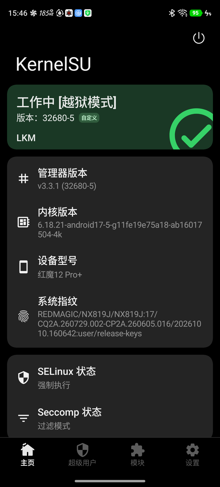

# 红魔 12 Pro+（NX819J）临时 Root 实测记录与工具

本项目记录一次在 **BL 保持锁定**的红魔 12 Pro+ 上加载 KernelSU、取得临时 Root 的实际过程，并提供电脑端检查、采样修正和执行脚本。

**状态：一台手机、一次启动内成功。公开版脚本通过离线检查及已 Root 状态下的检查，尚未完成重启后重新激活的端到端复测。请把它当作有明确版本限制的实验流程。**

公开的是流程和配套脚本。核心提权程序来自第三方工具包，仓库提供作者入口、文件校验值和本地提取程序，不镜像分发 APK、内核模块、符号表或提权二进制。参见 [第三方来源与许可](THIRD_PARTY.md)。

## 1. 先确认自己的版本

| 项目 | 本次实测值 |
| --- | --- |
| 手机 | 红魔 12 Pro+，型号 `NX819J` |
| Android | 17 |
| 系统 | RedMagicOS 12.0.15MR |
| 系统增量版本 | `20261010.160642` |
| 安全补丁日期 | `2026-08-05` |
| 完整内核版本 | `6.18.21-android17-5-g11fe19e75a18-ab16017504-4k` |
| Bootloader | 保持锁定 |
| KernelSU | `v3.3.1 (32680-5)`，LKM，界面显示“工作中［越狱模式］” |
| 实测日期 | 2026-11-14 |

**不能仅凭“同款手机”“Android 17”或“6.18.21”就认为适用。** 脚本要求型号、完整内核字符串和系统增量版本全部匹配；即使匹配，也不等于每台设备都能成功。不要修改 `materials.json` 绕过检查。

本流程不解 BL、不刷写 boot/init_boot/ABL 等原始分区，也没有执行恢复出厂。但上游程序会改动内核运行状态，在 `/data/adb` 等位置安装辅助文件，并调整包管理相关文件；不能理解成“完全不写文件”。请只在本人或明确授权的测试设备上使用。

## 2. 临时 Root 能保留多久

- 当前启动期间，已验证 `su` 能获得 root，KernelSU 模块为 Live，最终 SELinux 为 Enforcing。
- 完整重启后，运行中的内核模块会丢失，Root 需要重新取得；管理器和部分辅助文件可能仍在。
- 系统更新通常包含重启，还可能更换内核或修补利用条件。更新后不能直接照搬旧物料，版本不匹配时脚本会停止。
- 本次没有进行重启重新激活、OTA 后复现或长时间稳定性测试，不能承诺日常稳定、游戏兼容或模块兼容。

## 3. 准备电脑和手机

下文以 Windows PowerShell 为例。需要 [Python 3.10 或更新版本](https://www.python.org/downloads/windows/)、[Android SDK Platform-Tools（ADB）](https://developer.android.com/tools/releases/platform-tools) 和能解压 7z 的工具。

1. 本仓库点击 **Code → Download ZIP**，解压到例如 `D:\NX819J\repo`。确认其中有 `nx819j_root.py`、`prepare_assets.py` 和 `materials.json`。
2. 将 Platform-Tools 解压到 `D:\NX819J\platform-tools`。使用其他目录时，请替换后面命令中的路径。
3. 手机开启开发者选项和 USB 调试，用 USB 连接电脑，在手机弹窗中允许这台电脑调试，保持手机解锁。
4. 先只连接这一台安卓设备，在仓库文件夹打开 PowerShell。

```powershell
py -3 --version
& "D:\NX819J\platform-tools\adb.exe" devices
```

ADB 列表应显示一台状态为 `device` 的设备。`unauthorized` 表示还没在手机上允许调试；`offline` 表示连接尚未正常。ADB 输出包含设备标识，发截图求助时请打码。

电脑只有 `python` 命令时，把所有 `py -3` 替换成 `python`。本项目不需要安装任何 pip 依赖。

## 4. 获取本次测试对应的物料

上游作者：**卒迹v**。

- [作者教程](https://www.bilibili.com/video/BV1KFxK6ZEZF)
- [作者置顶评论提供的下载入口](https://wwbne.lanzoue.com/iICRi4dnrlsh)，公开提取密码：`6gef`
- 下载名称：`临时root.7z`

链接和内容由作者维护，可能变化。本仓库只接受记录的文件，不会自动信任同名新版。

| 文件 | SHA-256 |
| --- | --- |
| 临时root.7z | `518cf77c4bbeecd58f13f576bf46069089c61003a90eb33708e5cd41598d64ff` |
| 越狱助手_3.0.0.Apk | `4121f71b30589baf81b2aef96859b91034af4b1bc47f283ab4a981041b2bd694` |
| KernelSU.apk | `b4a059ace71de2fa65cc7f12b1c58d55fc23ab25e057ee4230ce779742abe450` |

先查看压缩包校验值：

```powershell
Get-FileHash "D:\NX819J\临时root.7z" -Algorithm SHA256
```

大小写不影响比较，字符应全部一致。解压后，把 `越狱助手_3.0.0.Apk` 和 `KernelSU.apk` 放进仓库的 `vendor` 文件夹：

```text
repo/
  nx819j_root.py
  prepare_assets.py
  materials.json
  vendor/
    越狱助手_3.0.0.Apk
    KernelSU.apk
```

提取配套物料：

```powershell
py -3 .\prepare_assets.py --apk ".\vendor\越狱助手_3.0.0.Apk"
```

成功会显示“已校验并提取 10 个文件”。程序先核对完整 APK，再逐个核对所需文件的大小和 SHA-256，保存到 `vendor/assets`，不会安装或执行这个 APK。

**本电脑端流程不需要安装“越狱助手”或 Shizuku。** 越狱助手 APK 在这里仅作为原作者物料容器；本项目没有修复原 APK 的手机端按钮。

## 5. 安装 KernelSU 管理器

先核对 `KernelSU.apk` 的 SHA-256，与上表一致后再安装：

```powershell
Get-FileHash ".\vendor\KernelSU.apk" -Algorithm SHA256
& "D:\NX819J\platform-tools\adb.exe" install -r ".\vendor\KernelSU.apk"
```

若手机要求安装确认，在手机上完成。这里只安装管理界面，**安装 APK 本身不会取得 Root**。已有不同 Root 管理器或不同版本时，请先停下核对，不要为了匹配指南直接卸载正在使用的管理器。

执行阶段还会核对手机上实际安装的管理器 APK 哈希，拒绝同包名、不同文件的情况。

## 6. 先做只读检查

```powershell
py -3 .\nx819j_root.py --adb "D:\NX819J\platform-tools\adb.exe"
```

默认只查询设备条件和当前 Root 状态，不上传采样工具、不执行提权。如果尚未 Root，应看到“只读检查完成”；这只说明前置条件通过，不代表漏洞一定可用。

如果已经 Root，会检查 `uid=0`、KernelSU 模块、SELinux 和 BL 状态，然后退出，不会重复提权。

多台设备必须同时连接时，在脚本命令末尾加 `--serial "目标设备标识"`。未明确选择而检测到多台设备时，程序会停止。直接使用 ADB 的命令则需在 `shell` 或 `install` 前加 `-s "目标设备标识"`。

## 7. 执行临时 Root

前置检查和物料校验均通过后执行：

```powershell
py -3 .\nx819j_root.py --adb "D:\NX819J\platform-tools\adb.exe" --activate
```

也可使用 Windows 入口：

```powershell
.\activate.cmd --adb "D:\NX819J\platform-tools\adb.exe"
```

`activate.cmd` 自带 `--activate`，会真正执行流程，不是只读检查按钮。

程序依次完成版本与文件检查、当前启动的采样、独立采样校验、调用上游提权及 KernelSU 加载流程、最终状态验证。保持 USB 连接，不要同时点手机端工具的提权按钮。执行包含等待和尝试过程，不保证固定耗时；电脑端最多等待 75 分钟，不自动重复整套流程。

正常完成的最后输出应包含：

```text
Root=uid0; KernelSU=Live; SELinux=Enforcing; BL=locked
```

只有最终验证通过才能判断成功；看到 `DONE` 或管理器被打开不能单独代替验证。在手机打开 KernelSU，确认显示“工作中［越狱模式］”。需要给其他应用 Root 时，在 KernelSU 的超级用户页面给相应应用授权，本项目没有批量授权其他应用。



也可手动核对：

```powershell
& "D:\NX819J\platform-tools\adb.exe" shell "su -c 'id; getenforce; grep kernelsu /proc/modules'"
& "D:\NX819J\platform-tools\adb.exe" shell getprop ro.boot.flash.locked
```

应看到 `uid=0(root)`、`Enforcing`、`kernelsu ... Live ...`，最后一条返回 `1`。如手机弹出 Root 授权请求，只确认自己正在进行的 ADB Shell 检查。

## 8. 失败、重启和系统更新

| 现象 | 处理 |
| --- | --- |
| 型号、完整内核或增量版本不匹配 | 停止，不要修改检查值硬跑。 |
| APK 或物料哈希不同 | 重新核对作者文件；同名不等于同一版本。 |
| BAD_SLIDE、锚点为空、独立校验失败 | 本次采样未成立，不能使用旧地址，见[故障说明](docs/TROUBLESHOOTING.md)。 |
| 残留提权进程，或起始状态是 Permissive | 正常重启后重新评估，不叠加执行。 |
| DONE 后最终验证失败 | 不能算成功，先保留日志并检查状态。 |
| 断开 USB、超时或 Ctrl+C | 电脑端停止等待不等于设备端回滚，不要立即重跑。 |
| 重启后管理器仍在但不工作 | APK 留着不会自动恢复临时 Root；相同版本可按流程重新评估，尚未保证重启复现成功。 |
| 更新后失效 | 需要重新确认新版本适配，本项目不提供降级绕过方案。 |

日志位于 `logs/日期-随机值/`，可能含启动标识、运行时内核地址和文件路径，**不要直接上传整个日志文件夹**。求助时可提供型号、完整内核、增量版本、失败阶段及打码报错。`vendor/` 和 `logs/` 已被 `.gitignore` 排除。

## 9. 这次修改了什么

原工具两次失败时，原始采样有大量事件，但文本锚点为零。原脚本先启动会消耗缓冲区的 `trace_pipe_raw` 读取，再读取文本快照，影响了锚点获取。

修正流程先取文本快照，再启动原始事件读取。本次成功采样得到 7,088 行文本、原求解器 7 票、独立检查匹配到 19 个符号；采样还绑定当前启动，重启后不能复用。原求解器、最低票数和目标检查仍会执行。

公开版增加设备选择、精确版本及物料检查，并把上游脚本的 `nx819j-*` 通配目录清理收窄到本次随机目录。核心提权二进制没有修改。详见[实测记录与验证边界](docs/TESTED.md)。

## 10. 文件与来源

| 文件 | 用途 |
| --- | --- |
| `materials.json` | 版本、来源、10 个物料的哈希和大小 |
| `prepare_assets.py` | 从指定 APK 提取并校验物料 |
| `nx819j_root.py` | 电脑端检查与显式激活入口 |
| `activate.cmd` | Windows 激活入口 |
| `scripts/capture.sh` | 修正采样顺序，保存并恢复跟踪开关 |
| `scripts/use_capture.sh` | 限制采样在同一次启动内复用 |
| `tests/` | 设备选择、哈希及采样一致性测试 |

离线测试命令：`py -3 -m unittest discover -s tests -v`。

感谢作者卒迹v、[KernelSU](https://github.com/tiann/KernelSU)及[公开采样研究参考](https://github.com/Feng1586/CVE-2026-64560-public)。后者覆盖其他机型，不能视作本机二进制的完整源码或通用兼容证明。[KernelSU 官方文档](https://kernelsu.org/guide/installation.html)可帮助理解 LKM；本文的漏洞加载流程不代表官方推荐或认证。

原创文档和脚本按 [MIT](LICENSE) 授权，外部物料不因此获得 MIT 授权，详见 [THIRD_PARTY.md](THIRD_PARTY.md)。
